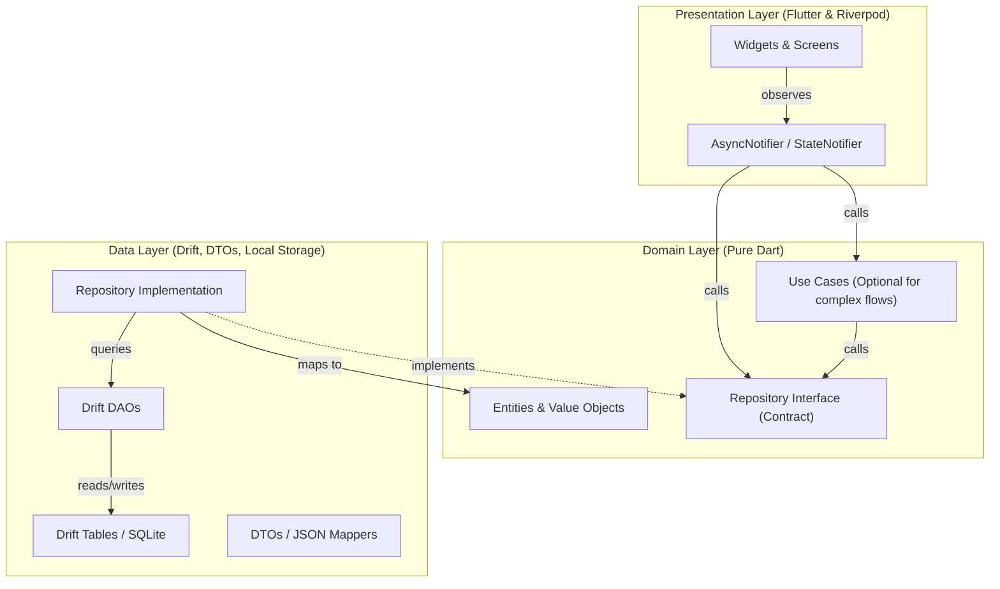
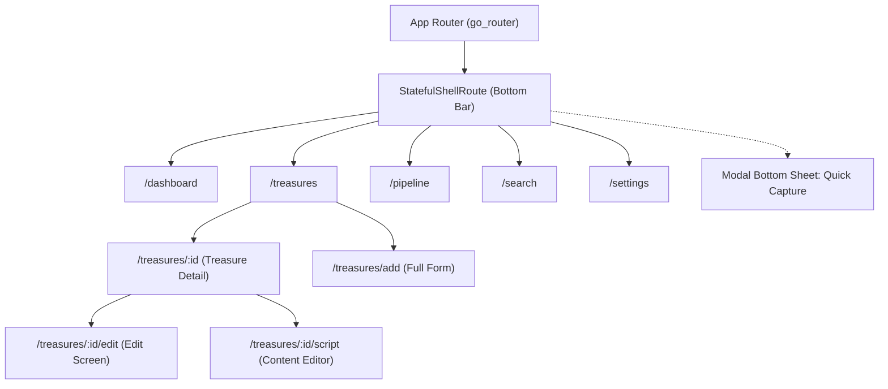

# 🏛️ Architecture & System Design Specification

This document provides the authoritative technical architecture for **Tech Treasure Database**, an offline-first Flutter application engineered for technology content creators and researchers.

---

## 1. Architectural Principles

Tech Treasure is designed around five foundational engineering principles:

1. **Feature-First Organization**: Code is grouped by business domain/feature rather than technical layer at the root level.
2. **Clean Architecture Separation**: Pure business logic (Domain) remains entirely decoupled from database drivers, frameworks, and UI widgets.
3. **Single Source of Truth (SSOT)**: The local SQLite database (accessed via Drift) is the definitive state of the application. The UI observes database streams via Riverpod.
4. **Resilient Offline-First Data Pipeline**: All CRUD, search, filter, pipeline moves, and backup actions execute without any network dependencies.
5. **Functional Error Handling**: Explicit, type-safe error handling using `Result<T, Failure>` replaces untyped exception throwing in domain and data boundaries.

---

## 2. Layered Structure (Feature-First)

The project structure divides responsibilities into `core/` for shared cross-cutting concerns and `features/` for domain-specific verticals.

```text
lib/
├── core/
│   ├── constants/               # Global constants, default categories, enums
│   ├── database/                # Drift database instance, schema, tables, DAOs
│   │   ├── daos/                # Data Access Objects (TreasuresDao, SourcesDao, etc.)
│   │   ├── tables/              # Drift Table declarations
│   │   ├── app_database.dart    # Database class with migrations & connection
│   │   └── connection/          # Native SQLite platform connection (Android/iOS/Desktop)
│   ├── errors/                  # Custom Failure classes & Exception handlers
│   │   ├── failures.dart        # Domain failure hierarchy
│   │   └── exceptions.dart      # Low-level data exceptions
│   ├── router/                  # go_router declarative route definitions
│   │   ├── app_router.dart      # Router configuration & nested ShellRoute
│   │   └── route_names.dart     # Static string route identifiers & paths
│   ├── theme/                   # Material 3 styling tokens
│   │   ├── app_colors.dart      # Deep sapphire, warm gold, status badges
│   │   ├── app_theme.dart       # ThemeData definitions for Light & Dark
│   │   └── app_typography.dart  # Type scale configurations
│   ├── utils/                   # Shared pure utility helpers
│   │   ├── date_formatter.dart  # Human-readable dates (relative & explicit)
│   │   ├── id_generator.dart    # UUID v4 generator
│   │   └── result.dart          # Functional Result<T, Failure> monad
│   └── widgets/                 # Reusable atomic UI components
│       ├── app_card.dart        # Styled container with subtle border
│       ├── status_badge.dart    # Visual pill for lifecycle stages
│       ├── star_rating.dart     # Interactive 1–5 star potential widget
│       ├── search_bar_input.dart# Debounced search input
│       └── empty_state_view.dart# Consistent empty states
│
├── features/
│   ├── dashboard/               # Overview metrics, stats, "Treasure of the Day"
│   ├── treasures/               # Treasure CRUD, detail views, reorderable steps
│   ├── research/                # Citations, sources, and research log tracking
│   ├── testing/                 # Test logs, verification checklist, compatibility
│   ├── pipeline/                # Kanban production board (drag/tap lifecycle)
│   ├── content/                 # Script editor, hooks, CTAs, platform targeting
│   ├── analytics/               # Manual performance snapshots (views, likes, saves)
│   └── settings/                # JSON backup/restore, CSV export, preferences
│
└── main.dart                    # App entry point, ProviderScope, initialization
```

---

## 3. The Three Clean Architecture Layers

Within each feature folder (e.g., `features/treasures/`), the code is divided into three distinct layers:



### 3.1 Domain Layer (Pure Dart)
- Contains zero Flutter widgets or third-party storage code.
- **Entities**: Business objects (e.g., `Treasure`, `Source`, `TestRecord`, `Content`) that encapsulate core identity and business rules.
- **Repository Contracts**: Abstract interfaces declaring data operations (e.g., `abstract class ITreasureRepository`).
- **Failures**: Specific failure representations (e.g., `TreasureNotFoundFailure`).

### 3.2 Data Layer
- **DAOs & Tables**: Drift queries and schema definitions using SQLite.
- **Repository Implementations**: Implements the domain contract by coordinating Drift DAOs, serializing/deserializing DTOs, and handling local exceptions.
- **Mappers**: Extensions converting Drift generated rows to pure Domain entities:
  ```dart
  extension TreasureDataMapper on TreasureRow {
    Treasure toEntity({required List<Tag> tags, required Category category}) => ...;
  }
  ```

### 3.3 Presentation Layer
- **Screens & Widgets**: Pure declarative Flutter UI widgets consuming state.
- **Riverpod AsyncNotifiers**: Manages view state, exposes reactive Streams, handles user events, and converts domain `Result` into UI states (loading, error, loaded).

---

## 4. State Management with Riverpod

State management relies on [Flutter Riverpod 2.x](https://riverpod.dev) using code generation (`@riverpod`) or standard `AsyncNotifier`.

### 4.1 Reactive Single Source of Truth
Drift exposes reactive SQLite queries as Dart `Stream`s. Riverpod binds these streams directly to the UI:

```dart
@riverpod
Stream<List<Treasure>> watchTreasuresList(
  WatchTreasuresListRef ref, {
  TreasureFilter? filter,
}) {
  final repository = ref.watch(treasureRepositoryProvider);
  return repository.watchAllTreasures(filter: filter);
}
```

When any record is added or modified anywhere in the app, Drift automatically emits the updated list, which Riverpod passes to the UI with zero manual polling.

### 4.2 Notifier State Controller Pattern
For mutating operations (e.g., adding a treasure, updating a pipeline status):

```dart
@riverpod
class TreasureDetailController extends _$TreasureDetailController {
  @override
  FutureOr<TreasureDetailState> build(String treasureId) async {
    final repository = ref.read(treasureRepositoryProvider);
    final treasure = await repository.getTreasureById(treasureId);
    return TreasureDetailState(treasure: treasure);
  }

  Future<void> updateStatus(TreasureStatus newStatus) async {
    state = const AsyncValue.loading();
    final repository = ref.read(treasureRepositoryProvider);
    final result = await repository.updateTreasureStatus(id: treasureId, status: newStatus);
    
    result.fold(
      onSuccess: (_) => ref.invalidateSelf(),
      onFailure: (failure) => state = AsyncValue.error(failure, StackTrace.current),
    );
  }
}
```

---

## 5. Navigation & Routing (go_router)

Tech Treasure uses [go_router](https://pub.dev/packages/go_router) for declarative, type-safe routing.

### 5.1 Nested Tab Navigation (ShellRoute)
The bottom navigation bar contains 5 primary tabs managed via a `StatefulShellRoute`:
1. **Home / Dashboard**: `/`
2. **Treasures**: `/treasures`
3. **Pipeline**: `/pipeline`
4. **Search**: `/search`
5. **Settings**: `/settings`



### 5.2 Deep Routes & State Preservation
- Detail screens (`/treasures/:id`) push on top of the tab stack while preserving the underlying list scroll position.
- Quick Capture opens as an adaptive Modal Bottom Sheet accessible from the global Floating Action Button regardless of the active tab.

---

## 6. Functional Error Handling

Instead of relying on unhandled runtime exceptions, Tech Treasure enforces a `Result<T, Failure>` return type on all repository and use case methods:

```dart
sealed class Result<T, E> {
  const Result();
  bool get isSuccess => this is Success<T, E>;
  bool get isFailure => this is FailureResult<T, E>;
  
  R fold<R>({
    required R Function(T data) onSuccess,
    required R Function(E error) onFailure,
  });
}

class Success<T, E> extends Result<T, E> {
  final T data;
  const Success(this.data);
  @override
  R fold<R>({required R Function(T data) onSuccess, required R Function(E error) onFailure}) => onSuccess(data);
}

class FailureResult<T, E> extends Result<T, E> {
  final E error;
  const FailureResult(this.error);
  @override
  R fold<R>({required R Function(T data) onSuccess, required R Function(E error) onFailure}) => onFailure(error);
}
```

### 6.1 Domain Failure Hierarchy
- `DatabaseFailure`: SQLite execution or corruption errors.
- `ValidationFailure`: Invalid user input (empty title, invalid URL format).
- `NotFoundFailure`: Requested entity not found in local store.
- `BackupCorruptFailure`: Malformed JSON or checksum mismatch during restore.

---

## 7. Performance & Offline SLA

| Metric | Target | Technical Mechanism |
|---|---|---|
| **App Startup Time** | < 600ms (Cold start) | Lazy database initialization, lightweight initial query |
| **Search Latency** | < 16ms (60 FPS fluid) | SQLite FTS5 (Full-Text Search) with indexed virtual table |
| **Database Scale** | 10,000+ records | Indexed relational foreign keys, batched cursor queries |
| **Memory Footprint** | < 120MB heap | Stream disposals on unmount, efficient Freezed memory models |
| **Backup Export Speed** | < 1.5s for 5,000 items | Streaming JSON encoder inside Drift background compute isolate |

