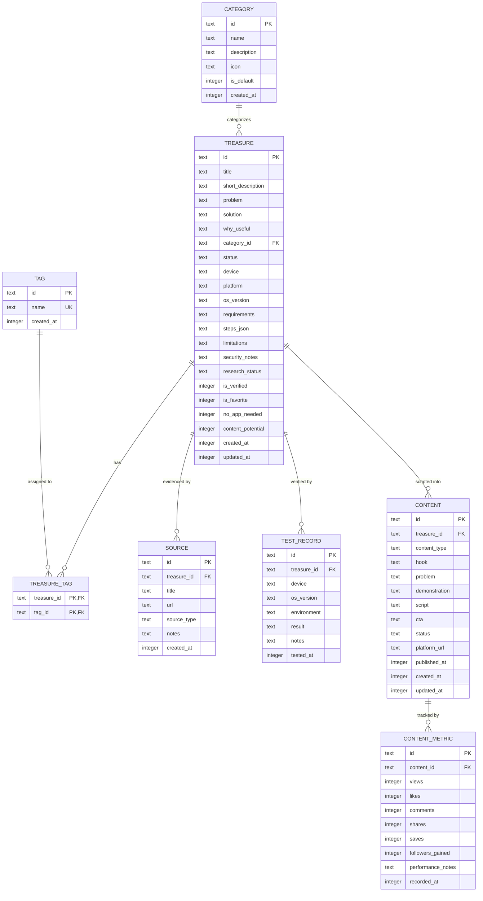

# 🗄️ Database Schema & Persistence Specification

This document specifies the relational database schema, SQLite tables, Drift definitions, indexing strategy, and migration management for **Tech Treasure Database**.

---

## 1. Entity-Relationship (ER) Diagram



---

## 2. Table Specifications

All primary keys use UUID v4 strings for distributed unique identification and collision-free JSON backup restore. All timestamps are stored as Unix millisecond integers (`INTEGER`).

### 2.1 `categories`
Stores predefined and user-created classification groups.

| Column | Type | Constraints | Description |
|---|---|---|---|
| `id` | `TEXT` | `PRIMARY KEY` | UUID v4 |
| `name` | `TEXT` | `NOT NULL UNIQUE` | Category display name |
| `description` | `TEXT` | `NULL` | Optional descriptive helper text |
| `icon` | `TEXT` | `NOT NULL` | Material icon name or codepoint identifier |
| `is_default` | `INTEGER` | `NOT NULL DEFAULT 0` | 1 if system seeded; 0 if user created |
| `created_at` | `INTEGER` | `NOT NULL` | Timestamp (milliseconds since epoch) |

### 2.2 `tags`
Normalized tag storage for multi-axis cross-referencing.

| Column | Type | Constraints | Description |
|---|---|---|---|
| `id` | `TEXT` | `PRIMARY KEY` | UUID v4 |
| `name` | `TEXT` | `NOT NULL UNIQUE COLLATE NOCASE` | Normalized tag string (e.g., `#android`) |
| `created_at` | `INTEGER` | `NOT NULL` | Timestamp |

### 2.3 `treasures`
Core table encapsulating the technology discovery record.

| Column | Type | Constraints | Description |
|---|---|---|---|
| `id` | `TEXT` | `PRIMARY KEY` | UUID v4 |
| `title` | `TEXT` | `NOT NULL` | Clear, actionable discovery title |
| `short_description` | `TEXT` | `NOT NULL` | Brief 1-2 sentence synopsis |
| `problem` | `TEXT` | `NULL` | Real-world problem or pain point addressed |
| `solution` | `TEXT` | `NULL` | Concrete technical solution |
| `why_useful` | `TEXT` | `NULL` | Explains why a user/creator cares |
| `category_id` | `TEXT` | `NOT NULL REFERENCES categories(id)` | Foreign key to Category |
| `status` | `TEXT` | `NOT NULL DEFAULT 'idea'` | Pipeline status enum (see Section 3) |
| `device` | `TEXT` | `NULL` | e.g., Android, iPhone, Windows PC |
| `platform` | `TEXT` | `NULL` | e.g., Mobile, Desktop, Web |
| `os_version` | `TEXT` | `NULL` | e.g., Android 14+, Windows 11 23H2 |
| `requirements` | `TEXT` | `NULL` | Pre-requisites (e.g., same Wi-Fi, OTG cable) |
| `steps_json` | `TEXT` | `NULL` | JSON array of reorderable string instructions |
| `limitations` | `TEXT` | `NULL` | Caveats, network limits, hardware restrictions |
| `security_notes` | `TEXT` | `NULL` | Digital safety/privacy cautions |
| `research_status` | `TEXT` | `NOT NULL DEFAULT 'not_researched'` | `not_researched`, `researching`, `complete` |
| `is_verified` | `INTEGER` | `NOT NULL DEFAULT 0` | 1 if verified; 0 if unverified |
| `is_favorite` | `INTEGER` | `NOT NULL DEFAULT 0` | 1 if starred/favorited; 0 otherwise |
| `no_app_needed` | `INTEGER` | `NOT NULL DEFAULT 0` | 1 if native trick without 3rd party apps |
| `content_potential` | `INTEGER` | `NOT NULL DEFAULT 3` | Manual 1 to 5 star rating |
| `created_at` | `INTEGER` | `NOT NULL` | Timestamp created |
| `updated_at` | `INTEGER` | `NOT NULL` | Timestamp last modified |

### 2.4 `treasure_tags`
Many-to-many junction table linking treasures and tags.

| Column | Type | Constraints | Description |
|---|---|---|---|
| `treasure_id` | `TEXT` | `NOT NULL REFERENCES treasures(id) ON DELETE CASCADE` | Composite PK part 1 |
| `tag_id` | `TEXT` | `NOT NULL REFERENCES tags(id) ON DELETE CASCADE` | Composite PK part 2 |

`PRIMARY KEY (treasure_id, tag_id)`

### 2.5 `sources`
Research documentation, URLs, and evidence citations.

| Column | Type | Constraints | Description |
|---|---|---|---|
| `id` | `TEXT` | `PRIMARY KEY` | UUID v4 |
| `treasure_id` | `TEXT` | `NOT NULL REFERENCES treasures(id) ON DELETE CASCADE` | Parent treasure |
| `title` | `TEXT` | `NOT NULL` | Source name (e.g., "Microsoft Docs") |
| `url` | `TEXT` | `NULL` | Optional web link |
| `source_type` | `TEXT` | `NOT NULL` | Enum: `official_doc`, `youtube`, `reddit`, etc. |
| `notes` | `TEXT` | `NULL` | Key quotes, claims, or takeaways |
| `created_at` | `INTEGER` | `NOT NULL` | Timestamp |

### 2.6 `test_records`
Empirical multi-device verification logs.

| Column | Type | Constraints | Description |
|---|---|---|---|
| `id` | `TEXT` | `PRIMARY KEY` | UUID v4 |
| `treasure_id` | `TEXT` | `NOT NULL REFERENCES treasures(id) ON DELETE CASCADE` | Parent treasure |
| `device` | `TEXT` | `NOT NULL` | Tested device (e.g., Samsung Galaxy S24) |
| `os_version` | `TEXT` | `NOT NULL` | OS version (e.g., Android 16) |
| `environment` | `TEXT` | `NULL` | e.g., Windows 11 Home, Wi-Fi 6 |
| `result` | `TEXT` | `NOT NULL` | Enum: `works`, `partially_works`, `fails` |
| `notes` | `TEXT` | `NULL` | Observations during hands-on testing |
| `tested_at` | `INTEGER` | `NOT NULL` | Date test was performed |

### 2.7 `contents`
Scripting and production deliverables derived from a verified treasure.

| Column | Type | Constraints | Description |
|---|---|---|---|
| `id` | `TEXT` | `PRIMARY KEY` | UUID v4 |
| `treasure_id` | `TEXT` | `NOT NULL REFERENCES treasures(id) ON DELETE CASCADE` | Parent treasure |
| `content_type` | `TEXT` | `NOT NULL` | Enum: `tiktok`, `reel`, `short`, `youtube_video`, `blog` |
| `hook` | `TEXT` | `NULL` | 3-second opening hook |
| `problem` | `TEXT` | `NULL` | Problem narrative description |
| `demonstration` | `TEXT` | `NULL` | Demonstration instructions / B-roll plan |
| `script` | `TEXT` | `NULL` | Full video script (Markdown formatted) |
| `cta` | `TEXT` | `NULL` | Call to action outro |
| `status` | `TEXT` | `NOT NULL DEFAULT 'idea'` | Pipeline status: `scripted`, `recorded`, etc. |
| `platform_url` | `TEXT` | `NULL` | Live URL once published |
| `published_at` | `INTEGER` | `NULL` | Date of publication |
| `created_at` | `INTEGER` | `NOT NULL` | Timestamp |
| `updated_at` | `INTEGER` | `NOT NULL` | Timestamp |

### 2.8 `content_metrics`
Post-publication analytics snapshots.

| Column | Type | Constraints | Description |
|---|---|---|---|
| `id` | `TEXT` | `PRIMARY KEY` | UUID v4 |
| `content_id` | `TEXT` | `NOT NULL REFERENCES contents(id) ON DELETE CASCADE` | Parent content |
| `views` | `INTEGER` | `NOT NULL DEFAULT 0` | Total view count |
| `likes` | `INTEGER` | `NOT NULL DEFAULT 0` | Like count |
| `comments` | `INTEGER` | `NOT NULL DEFAULT 0` | Comments count |
| `shares` | `INTEGER` | `NOT NULL DEFAULT 0` | Shares count |
| `saves` | `INTEGER` | `NOT NULL DEFAULT 0` | Bookmarks / saves count |
| `followers_gained` | `INTEGER` | `NOT NULL DEFAULT 0` | Attributed followers |
| `performance_notes` | `TEXT` | `NULL` | Qualitative creator insights |
| `recorded_at` | `INTEGER` | `NOT NULL` | Snapshot timestamp |

---

## 3. SQLite FTS5 Full-Text Search Virtual Table

To guarantee lightning-fast offline search across large knowledge bases, an FTS5 virtual table is created:

```sql
CREATE VIRTUAL TABLE IF NOT EXISTS treasures_fts USING fts5(
    id UNINDEXED,
    title,
    short_description,
    problem,
    solution,
    requirements,
    limitations,
    content='treasures',
    content_rowid='rowid'
);
```

Automated SQLite triggers keep `treasures_fts` synchronized during `INSERT`, `UPDATE`, and `DELETE` on the `treasures` table.

---

## 4. Default Seed Categories

Upon first database creation (migration v1), the following default categories are inserted:

```sql
INSERT INTO categories (id, name, description, icon, is_default, created_at) VALUES
('cat_phone_tricks', 'Phone Tricks', 'Mobile shortcuts, gesture controls & hidden settings', 'smartphone', 1, 1700000000000),
('cat_whatsapp', 'WhatsApp', 'Privacy, storage, data saving & hidden messaging features', 'chat', 1, 1700000000000),
('cat_windows', 'Windows', 'PC optimizations, command-line power tools & fixes', 'desktop_windows', 1, 1700000000000),
('cat_phone_pc', 'Phone + PC', 'Cross-device integration, file sharing & casting', 'devices', 1, 1700000000000),
('cat_internet', 'Internet & Web', 'Browsing speed, bandwidth, networking & DNS tricks', 'wifi', 1, 1700000000000),
('cat_security', 'Digital Safety', 'Account protection, 2FA, scam prevention & privacy', 'security', 1, 1700000000000),
('cat_productivity', 'Productivity', 'Workflows, shortcuts, note-taking & file management', 'flash_on', 1, 1700000000000),
('cat_ghana_tech', 'Ghana / Africa Tech', 'Mobile money, low-data hacks, USSD & local tech solutions', 'public', 1, 1700000000000),
('cat_other', 'Other Discoveries', 'Uncategorized and experimental technology ideas', 'category', 1, 1700000000000);
```

---

## 5. Indexes for Performance

```sql
-- Fast lookup of treasures by category
CREATE INDEX IF NOT EXISTS idx_treasures_category ON treasures(category_id);

-- Fast pipeline view queries
CREATE INDEX IF NOT EXISTS idx_treasures_status ON treasures(status);

-- Filter combinations (Verified + No App Needed)
CREATE INDEX IF NOT EXISTS idx_treasures_verified_noapp ON treasures(is_verified, no_app_needed);

-- Favorites query
CREATE INDEX IF NOT EXISTS idx_treasures_favorites ON treasures(is_favorite);

-- Sort by creation or update
CREATE INDEX IF NOT EXISTS idx_treasures_updated ON treasures(updated_at DESC);

-- Relational lookups
CREATE INDEX IF NOT EXISTS idx_sources_treasure ON sources(treasure_id);
CREATE INDEX IF NOT EXISTS idx_test_records_treasure ON test_records(treasure_id);
CREATE INDEX IF NOT EXISTS idx_contents_treasure ON contents(treasure_id);
CREATE INDEX IF NOT EXISTS idx_content_metrics_content ON content_metrics(content_id);
```

---

## 6. Migration Strategy in Drift

Drift schema versions are incremented monotonically (`schemaVersion = 1`).
The `MigrationStrategy` handles:

```dart
@DriftDatabase(tables: [
  Treasures,
  Categories,
  Tags,
  TreasureTags,
  Sources,
  TestRecords,
  Contents,
  ContentMetrics,
])
class AppDatabase extends _$AppDatabase {
  AppDatabase(QueryExecutor e) : super(e);

  @override
  int get schemaVersion => 1;

  @override
  MigrationStrategy get migration => MigrationStrategy(
    onCreate: (Migrator m) async {
      await m.createAll();
      await seedDefaultCategories();
      await setupFtsTriggers();
    },
    onUpgrade: (Migrator m, int from, int to) async {
      // Future version migrations
    },
    beforeOpen: (details) async {
      await customStatement('PRAGMA foreign_keys = ON');
    },
  );
}
```

