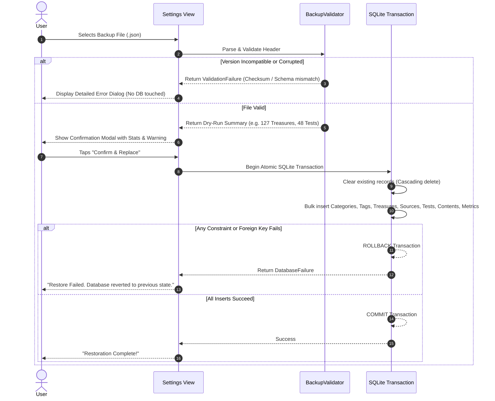

# 📦 Data Models & Backup Specification (JSON v1.0 & CSV)

This document specifies the domain data structures, enums, JSON backup specification, validation protocol, and CSV export layout for **Tech Treasure Database**.

---

## 1. Domain Enums

### 1.1 `TreasureStatus`
Defines the lifecycle stage of a technology discovery:
```dart
enum TreasureStatus {
  idea,
  researching,
  testing,
  verified,
  readyToCreate,
  scripted,
  recorded,
  edited,
  published,
}
```

### 1.2 `ResearchStatus`
```dart
enum ResearchStatus {
  notResearched,
  researching,
  complete,
}
```

### 1.3 `VerificationStatus`
```dart
enum VerificationStatus {
  unverified,
  researching,
  verified,
  failed,
}
```

### 1.4 `TestResult`
```dart
enum TestResult {
  works,
  partiallyWorks,
  doesNotWork,
}
```

### 1.5 `ContentType`
```dart
enum ContentType {
  tiktok,
  instagramReel,
  youtubeShort,
  youtubeVideo,
  facebookReel,
  blog,
  other,
}
```

### 1.6 `SourceType`
```dart
enum SourceType {
  officialDoc,
  youtube,
  reddit,
  blog,
  forum,
  personalDiscovery,
  other,
}
```

---

## 2. Core Domain Models (Freezed Representation)

### 2.1 `Treasure`
```dart
@freezed
class Treasure with _$Treasure {
  const factory Treasure({
    required String id,
    required String title,
    required String shortDescription,
    String? problem,
    String? solution,
    String? whyUseful,
    required String categoryId,
    @Default(TreasureStatus.idea) TreasureStatus status,
    String? device,
    String? platform,
    String? osVersion,
    String? requirements,
    @Default([]) List<String> steps,
    String? limitations,
    String? securityNotes,
    @Default(ResearchStatus.notResearched) ResearchStatus researchStatus,
    @Default(false) bool isVerified,
    @Default(false) bool isFavorite,
    @Default(false) bool noAppNeeded,
    @Default(3) int contentPotential, // 1 to 5
    required DateTime createdAt,
    required DateTime updatedAt,
    // Joined relations (optional in lightweight list queries)
    Category? category,
    @Default([]) List<Tag> tags,
    @Default([]) List<Source> sources,
    @Default([]) List<TestRecord> testRecords,
    @Default([]) List<Content> contents,
  }) = _Treasure;

  factory Treasure.fromJson(Map<String, dynamic> json) => _$TreasureFromJson(json);
}
```

---

## 3. JSON Backup Specification (v1.0)

Since Tech Treasure is completely offline-first, users must have a deterministic, fail-safe export/restore mechanism.

### 3.1 Backup File Standard
- **File Extension**: `.json` (suggested naming: `tech_treasure_backup_YYYYMMDD_HHMMSS.json`)
- **Encoding**: UTF-8
- **Payload Structure**: Envelope metadata header + relational entities payload.

### 3.2 Schema Structure

```json
{
  "version": "1.0.0",
  "schemaVersion": 1,
  "exportedAt": "2026-11-10T17:00:00.000Z",
  "appVersion": "1.0.0+1",
  "metadata": {
    "totalTreasures": 1,
    "totalCategories": 1,
    "totalTags": 2,
    "totalSources": 1,
    "totalTestRecords": 1,
    "totalContents": 1,
    "totalMetrics": 1,
    "checksum": "sha256-abcdef1234567890..."
  },
  "data": {
    "categories": [
      {
        "id": "cat_phone_pc",
        "name": "Phone + PC",
        "description": "Cross-device integration, file sharing & casting",
        "icon": "devices",
        "isDefault": true,
        "createdAt": 1700000000000
      }
    ],
    "tags": [
      {
        "id": "tag_android",
        "name": "#android",
        "createdAt": 1700000000000
      },
      {
        "id": "tag_mouse",
        "name": "#mouse",
        "createdAt": 1700000000000
      }
    ],
    "treasures": [
      {
        "id": "9b1deb4d-3b7d-4bad-9bdd-2b0d7b3dcb6d",
        "title": "Turn Your Android Phone Into a PC Mouse",
        "shortDescription": "Use an Android phone as a wireless trackpad and mouse.",
        "problem": "User does not have a physical mouse or battery died.",
        "solution": "Use phone touchscreen as a Wi-Fi/Bluetooth mouse replacement.",
        "whyUseful": "Essential backup tool when traveling or mouse fails.",
        "categoryId": "cat_phone_pc",
        "status": "published",
        "device": "Android",
        "platform": "Windows",
        "osVersion": "Android 10+, Windows 11",
        "requirements": "Wi-Fi connection on same local subnet",
        "steps": [
          "1. Install client on Windows",
          "2. Pair phone via Wi-Fi IP",
          "3. Use screen as touchpad"
        ],
        "limitations": "Does not work over guest Wi-Fi isolation networks",
        "securityNotes": "Ensure connection requires PIN pairing",
        "researchStatus": "complete",
        "isVerified": true,
        "isFavorite": true,
        "noAppNeeded": false,
        "contentPotential": 5,
        "createdAt": 1700000000000,
        "updatedAt": 1700001000000,
        "tagIds": ["tag_android", "tag_mouse"]
      }
    ],
    "sources": [
      {
        "id": "src_001",
        "treasureId": "9b1deb4d-3b7d-4bad-9bdd-2b0d7b3dcb6d",
        "title": "KDE Connect Official Documentation",
        "url": "https://kdeconnect.kde.org",
        "sourceType": "officialDoc",
        "notes": "Verified open source solution with zero ads.",
        "createdAt": 1700000050000
      }
    ],
    "testRecords": [
      {
        "id": "test_001",
        "treasureId": "9b1deb4d-3b7d-4bad-9bdd-2b0d7b3dcb6d",
        "device": "Samsung Galaxy S24",
        "osVersion": "Android 16",
        "environment": "Windows 11 23H2",
        "result": "works",
        "notes": "Sub-millisecond latency on 5GHz Wi-Fi.",
        "testedAt": 1700000100000
      }
    ],
    "contents": [
      {
        "id": "cnt_001",
        "treasureId": "9b1deb4d-3b7d-4bad-9bdd-2b0d7b3dcb6d",
        "contentType": "youtubeShort",
        "hook": "Your phone is secretly a wireless PC mouse, and here is how to turn it on in 30 seconds.",
        "problem": "Imagine you are about to present and your mouse dies.",
        "demonstration": "Show phone screen controlling PC cursor smoothly.",
        "script": "Full script text with B-roll cues...",
        "cta": "Save this video for when your mouse dies!",
        "status": "published",
        "platformUrl": "https://youtube.com/shorts/example",
        "publishedAt": 1700005000000,
        "createdAt": 1700000200000,
        "updatedAt": 1700005000000
      }
    ],
    "contentMetrics": [
      {
        "id": "met_001",
        "contentId": "cnt_001",
        "views": 24500,
        "likes": 1820,
        "comments": 142,
        "shares": 520,
        "saves": 3410,
        "followersGained": 310,
        "performanceNotes": "High save ratio due to high emergency utility.",
        "recordedAt": 1700010000000
      }
    ]
  }
}
```

---

## 4. Safe Restore Protocol

Restoring a backup involves high risk of user data loss if corrupted. Tech Treasure implements a strict 6-stage restore workflow:



---

## 5. CSV Export Specification

For external data analysis in Excel, Google Sheets, or Notion, a flattened CSV export is provided.

### 5.1 Columns
1. `id`: Unique identifier
2. `title`: Title
3. `category`: Category name
4. `status`: Current lifecycle status
5. `is_verified`: Yes/No
6. `is_favorite`: Yes/No
7. `no_app_needed`: Yes/No
8. `content_potential`: 1 to 5
9. `device`: Target device
10. `platform`: Target platform
11. `os_version`: Supported OS versions
12. `sources_count`: Total citations
13. `tests_count`: Total empirical test logs
14. `has_content`: Yes/No (whether script/video created)
15. `published_date`: ISO 8601 date (if published)
16. `total_views`: Aggregated views across contents
17. `total_saves`: Aggregated saves across contents
18. `created_at`: Creation date
19. `updated_at`: Last update date

All text fields containing commas or newlines are standard RFC 4180 double-quoted.

