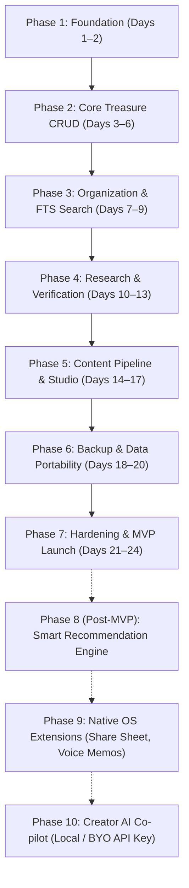

# 🗺️ Phased Product Roadmap

This document outlines the development trajectory of **Tech Treasure Database** from initial MVP foundation through advanced creator intelligence.

---

## 1. Roadmap Overview & Timeline

---

## 2. Phase Breakdown (MVP: 2–4 Weeks)

### Phase 1: Foundation (Days 1–2)
- [x] Establish Feature-First Clean Architecture structure.
- [x] Configure `pubspec.yaml` with core dependencies (Riverpod, Drift, go_router, Freezed).
- [x] Initialize Drift SQLite database with schema version 1 and seed default categories.
- [x] Implement Material 3 Theme with Deep Sapphire / Slate surfaces and Amber/Gold accents.
- [x] Implement nested Bottom Navigation ShellRoute via `go_router`.

### Phase 2: Treasure Management (Days 3–6)
- [x] Implement Treasure Entity, Drift DAO, and Repository implementations.
- [x] Build Treasure List screen with sorting (Recent, Updated, Potential).
- [x] Build Full "Add Treasure" form and Fast "Quick Capture" bottom sheet (<5s capture).
- [x] Build Treasure Detail screen with collapsible sections.
- [x] Implement Step reordering list widget (drag and drop).
- [x] Implement Favorite star toggle and "No App Needed" toggle.

### Phase 3: Organization & Sub-Millisecond Search (Days 7–9)
- [x] Implement Categories management (Default seeded + user created).
- [x] Implement Tagging system with many-to-many junction table.
- [x] Setup SQLite FTS5 virtual table (`treasures_fts`) with automated sync triggers.
- [x] Build Offline Search view with debounced real-time query execution.
- [x] Build multi-criteria Filter Modal (Category, Status, Device, Verified, No App Needed).

### Phase 4: Research & Empirical Verification (Days 10–13)
- [x] Implement Research Sources DAO (Name, Type, URL, notes).
- [x] Add URL validation and external browser launcher helper.
- [x] Implement empirical Verification Checklist (6-step quality gate).
- [x] Build Multi-Device Test Matrix:
  - Add Test Log (Device, OS, Environment, Result enum: Works/Partially/Fails, notes, date).
  - List historical test records on Detail screen.

### Phase 5: Content Production Studio (Days 14–17)
- [x] Build Kanban Pipeline view with horizontal columns:
  - `Ideas` ➔ `Research` ➔ `Testing` ➔ `Verified` ➔ `Scripted` ➔ `Recorded` ➔ `Edited` ➔ `Published`.
- [x] Card drag-and-drop or quick tap-to-move status modal.
- [x] Implement Script Studio:
  - Hook editor (3-second hook formulation).
  - Problem & demonstration planner.
  - Full Markdown script editor.
  - CTA selector.
- [x] **Teleprompter / Presentation Mode**:
  - Full-screen OLED black display with dynamic font scale and variable auto-scroll speed.
- [x] **Social Media Clipboard Formatter**:
  - One-tap formatted export for YouTube Shorts / Reels description / WhatsApp broadcasts.
- [x] Post-publication manual analytics recorder (Views, Likes, Saves, Shares, Notes).

### Phase 6: Backup, Data Portability & System Integration (Days 18–20)
- [x] **Android System Share Sheet Receiver**:
  - Receive URLs and text shared from Chrome, YouTube, or Twitter into Quick Capture.
- [x] Implement JSON Backup Generator v1.0 with SHA-256 integrity checksum.
- [x] Implement CSV Exporter for spreadsheet analysis (Excel / Google Sheets).
- [x] Build Safe Restore flow:
  - JSON schema validator.
  - Dry-run summary preview (counts of treasures, sources, tests).
  - Explicit destructive confirmation dialog.
  - Atomic database transaction with rollback protection.

### Phase 7: Polish & MVP Launch (Days 21–24)
- [x] Implement friendly empty states across all screens.
- [x] Conduct accessibility audit (min 48dp touch targets, WCAG AA contrast).
- [x] Test cold start and database scaling with 1,000+ mock records.
- [x] Finalize Android App Bundle signing and ProGuard configuration.
- [x] Ship MVP v1.0.0.

---

## 3. Post-MVP Evolution

### Phase 8: Smart Creator Intelligence (Post-MVP)
- **"What Should I Create Next?" Engine**:
  - Rule-based algorithmic prioritization:
    $$\text{Score} = (\text{Content Potential} \times 2) + (\text{Is Verified} \times 3) + (\text{No App Needed} \times 1.5) - (\text{Days Since Scripted} \times 0.1)$$
  - Surfaces high-probability viral topics.
- **Content Performance Correlation**:
  - Insights such as: *"Your Phone + PC tricks get 3.2× more saves than WhatsApp tutorials."*

### Phase 9: Native OS Extensions
- **Android Share Sheet Receiver**:
  - Share text, URLs, or YouTube links directly from Chrome/YouTube into Tech Treasure Quick Capture.
- **Media Attachments**:
  - Local screenshot storage linked to test records.
  - Audio memo voice recorder for fast verbal thoughts.

### Phase 10: Local / BYO AI Co-Pilot (Privacy-Preserving)
- Optional bring-your-own API key (Google Gemini / OpenAI) or on-device local model.
- Automatically drafts 3 hook variations, video scripts, and YouTube Shorts descriptions directly from empirical test notes.

