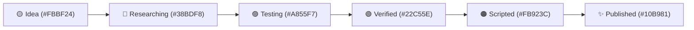

# 🎨 UI/UX Design System & Screen Specification

This document defines the visual design system, color tokens, typography, component guidelines, screen hierarchy, and accessibility standards for **Tech Treasure Database**.

---

## 1. Visual Theme: "Digital Treasure Chest"

The visual direction balances a subtle, rewarding **Treasure Chest** aesthetic with crisp, professional productivity tooling. It avoids gimmicks or cartoonish game graphics in favor of:
- Deep sapphire, slate, and charcoal surfaces.
- Warm amber/gold accents (`#F59E0B` / `#D97706`) providing focal points on key actions, star ratings, and verified badges.
- High-contrast, legible typography with generous whitespace.
- Restrained micro-interactions with gentle haptic feedback on completion states.

---

## 2. Color Palette & Semantic Tokens

### 2.1 Core Brand Colors

| Token Name | Light Mode Hex | Dark Mode Hex | Usage |
|---|---|---|---|
| `treasureGold` | `#D97706` (Amber 600) | `#F59E0B` (Amber 500) | Primary brand accent, star ratings, key CTA |
| `treasureGoldContainer` | `#FEF3C7` (Amber 100) | `#78350F` (Amber 900) | Highlight card backgrounds, active tab pills |
| `surfacePrimary` | `#FFFFFF` | `#0F172A` (Slate 900) | Main background |
| `surfaceCard` | `#F8FAFC` (Slate 50) | `#1E293B` (Slate 800) | Elevated cards, list items |
| `surfaceElevated` | `#F1F5F9` (Slate 100) | `#334155` (Slate 700) | Modals, bottom sheets, toolbars |
| `borderSubtle` | `#E2E8F0` (Slate 200) | `#334155` (Slate 700) | 1px card borders and dividers |
| `textPrimary` | `#0F172A` (Slate 900) | `#F8FAFC` (Slate 50) | Main headings and titles |
| `textSecondary` | `#475569` (Slate 600) | `#94A3B8` (Slate 400) | Subtitles, descriptions, captions |
| `textMuted` | `#94A3B8` (Slate 400) | `#64748B` (Slate 500) | Timestamps, empty state descriptions |

### 2.2 Semantic Lifecycle Badges



| Lifecycle Status | Background (Dark) | Foreground (Dark) | Label Display |
|---|---|---|---|
| `idea` | `#451A03` | `#FBBF24` | 💡 Idea |
| `researching` | `#082F49` | `#38BDF8` | 🔍 Researching |
| `testing` | `#3B0764` | `#C084FC` | 🧪 Testing |
| `verified` | `#052E16` | `#4ADE80` | ✅ Verified |
| `readyToCreate` | `#1E1B4B` | `#818CF8` | 🎬 Ready |
| `scripted` | `#431407` | `#FB923C` | 📝 Scripted |
| `recorded` | `#172554` | `#60A5FA` | 🎥 Recorded |
| `edited` | `#312E81` | `#A5B4FC` | ✂️ Edited |
| `published` | `#064E3B` | `#34D399` | 🚀 Published |

---

## 3. Typography Scale

Tech Treasure uses the default platform font (Inter / Roboto / SF Pro) optimized for legibility:

| Role | Weight | Size | Line Height | Usage |
|---|---|---|---|---|
| `displayLarge` | Bold (700) | 32sp | 40sp | Main metrics on Dashboard |
| `headlineMedium` | SemiBold (600) | 22sp | 28sp | Screen headers (Treasure Detail) |
| `titleMedium` | SemiBold (600) | 16sp | 24sp | Card titles, modal headers |
| `bodyMedium` | Regular (400) | 14sp | 20sp | Descriptions, steps, notes |
| `bodySmall` | Regular (400) | 12sp | 16sp | Limitations, requirements list |
| `labelSmall` | Medium (500) | 11sp | 14sp | Status badges, category pills, tags |

---

## 4. Key Screen Wireframe Layouts

### 4.1 Dashboard (`/`)

```text
┌──────────────────────────────────────────┐
│ Good morning 👋              [⚙️ Settings]│
│ Tech Treasure Knowledge Base             │
│                                          │
│ ┌──────────────────────────────────────┐ │
│ │ 💎 127 Total Treasures               │ │
│ │                                      │ │
│ │ 🟡 32 Ideas         🔵 14 Researching│ │
│ │ 🟣 8  Testing       🟢 41 Verified   │ │
│ │ 🎬 17 Ready         🚀 15 Published  │ │
│ └──────────────────────────────────────┘ │
│                                          │
│ 🔥 TREASURE OF THE DAY                   │
│ ┌──────────────────────────────────────┐ │
│ │ Turn Your Phone Into a PC Mouse      │ │
│ │ Category: Phone + PC  ⭐⭐⭐⭐⭐     │ │
│ │ "Use Android touchscreen as mouse"   │ │
│ │ [ Continue Research ➔ ]              │ │
│ └──────────────────────────────────────┘ │
│                                          │
│ QUICK ACTIONS                            │
│ [ 💡 Ideas ]   [ ✅ Verified ]          │
│ [ ⭐ Favorites ] [ 🚫 No App Needed ]   │
│                                          │
│ ━━━━━━━━━━━━━━━━━━━━━━━━━━━━━━━━━━━━━━━━ │
│ [Home] [Treasures] [Pipeline] [Search]   │
└──────────────────────────────────────────┘
```

### 4.2 Treasure Card Component

```text
┌──────────────────────────────────────────────┐
│ [Phone + PC]           [✅ Verified] [⭐]   │
│ Turn Your Android Phone Into a PC Mouse      │
│ Use your phone as an emergency wireless      │
│ mouse and trackpad over local Wi-Fi.         │
│                                              │
│ 🚫 No App Needed   ⭐⭐⭐⭐⭐ (Potential: 5) │
│ #android  #windows  #mouse                   │
│ Updated 2 hrs ago                            │
└──────────────────────────────────────────────┘
```

### 4.3 Quick Capture Bottom Sheet

```text
┌──────────────────────────────────────────────┐
│ 💡 Quick Capture Discovery          [ Close ]│
│                                              │
│ Title *                                      │
│ [ Check Samsung clipboard sharing with Win ] │
│                                              │
│ Category *                                   │
│ [ Phone + PC ▼ ]                             │
│                                              │
│ Quick Notes / Link (Optional)                │
│ [ Discovered via Twitter, needs Win 11 link] │
│                                              │
│ [x] No App Needed?   Initial Status: [Idea]  │
│                                              │
│ [         Save Treasure in 1-Tap           ] │
└──────────────────────────────────────────────┘
```

### 4.4 Treasure Detail Screen (`/treasures/:id`)

- **Top Bar**: Back button, Category pill, Favorite star toggle, Edit icon button.
- **Header Section**: Title (headlineMedium), Status badge (tappable to quick-advance), Creation date.
- **Action Strip**:
  - `[ + Add Test Log ]`
  - `[ 🎬 Write Script ]`
  - `[ 📋 Share/Clipboard ]`
  - `[ 📺 Teleprompter ]`
- **Overview Card**: Problem & Solution breakdown.
- **Technical Specs**: Device, Platform, OS Version, Prerequisites.
- **Numbered Steps**: Reorderable steps with drag handles and copy-to-clipboard button.
- **Verification Matrix**: Interactive checklist with pass/fail indicator.
- **Research Sources**: Accordion list of citations with direct tap-to-open URLs.
- **Test Matrix**: Historical device test cards (e.g. S24 Android 16 - `WORKS`).
- **Content Studio**: Attached hook, problem, script preview, and analytics.

### 4.5 Teleprompter / Presentation View (`/treasures/:id/teleprompter`)

Designed for creators recording video while looking at their mobile phone screen:
- **Full-Screen Immersion**: System bars hidden (`SystemChrome.setEnabledSystemUIMode(SystemUiMode.immersiveSticky)`).
- **High Contrast**: Pure OLED black (`#000000`) background with high-contrast text (`#FFFFFF`) to eliminate eye strain.
- **Dynamic Font Scaling**: Slider control adjusting font size between 18sp and 36sp.
- **Auto-Scroll Engine**: Variable scrolling speed (1x to 4x) with single-tap pause/play anywhere on screen.
- **Mirrored Mode Toggle**: Horizontally flips text for physical beam-splitter teleprompter glass rigs.

```text
┌──────────────────────────────────────────────┐
│ [✕ Exit]     Speed: [ ──●───── 2.0x ]  [Aa▼] │
│                                              │
│ HOOK:                                        │
│ Did you know your phone can secretly replace │
│ your computer mouse?                         │
│                                              │
│ DEMONSTRATION:                               │
│ 1. Open quick settings on phone              │
│ 2. Tap Connect to PC                         │
│ 3. Swipe to control cursor smoothly          │
│                                              │
│ CTA:                                         │
│ Follow for more daily tech hacks!            │
│                                              │
│ [  Tap Anywhere to Pause / Resume Scroll  ]  │
└──────────────────────────────────────────────┘
```

### 4.6 Social Media Clipboard Formatter Modal

Formats the Treasure into an instant, engaging copy-paste snippet for YouTube Shorts, Instagram Reels, TikTok captions, or WhatsApp broadcasts:

```text
┌──────────────────────────────────────────────┐
│ 📋 Copy for Social Media            [ Close ]│
│                                              │
│ Format Preset: [ YouTube Short / Reel ▼ ]    │
│                                              │
│ ┌──────────────────────────────────────────┐ │
│ │ 💡 Did you know your phone is a PC mouse?│ │
│ │                                          │ │
│ │ Steps:                                   │ │
│ │ 1. Install client on Windows             │ │
│ │ 2. Connect to same local Wi-Fi           │ │
│ │ 3. Use screen as wireless trackpad       │ │
│ │                                          │ │
│ │ 🚫 No extra app needed on phone!         │ │
│ │                                          │ │
│ │ #techtips #android #windows #lifehacks   │ │
│ └──────────────────────────────────────────┘ │
│                                              │
│ [       📋 Copy to Clipboard (1-Tap)       ] │
└──────────────────────────────────────────────┘
```

### 4.7 Android Share Sheet Receiver Flow

1. User highlights a link or tip in Chrome, YouTube, Reddit, or Twitter.
2. Taps system **Share** ➔ selects **Tech Treasure**.
3. App launches directly into **Quick Capture Modal** with the shared URL and title pre-filled.
4. User selects Category in 1 tap and saves directly into the SQLite database.

---

## 5. Empty States Specification

Every list and view provides encouraging, actionable empty states with a direct call to action:

### 5.1 No Treasures Yet
- **Icon**: `diamond_outlined` (64dp, Amber color)
- **Title**: "No Treasures Discovered Yet"
- **Subtitle**: "Start capturing useful technology tricks, hidden settings, and PC shortcuts."
- **Action**: Primary button `[ + Add First Treasure ]`

### 5.2 Empty Search Results
- **Icon**: `search_off` (48dp, Slate color)
- **Title**: "No Matching Treasures Found"
- **Subtitle**: "Try searching for a different keyword or reset active category filters."
- **Action**: Outlined button `[ Reset All Filters ]`

### 5.3 Empty Pipeline Stage
- **Icon**: `auto_awesome_motion` (40dp)
- **Title**: "No items in this stage"
- **Subtitle**: "Drag cards here or advance items from the previous column."

---

## 6. Accessibility & Responsiveness Standards

- **Touch Targets**: Minimum 48 × 48dp on all buttons, checkboxes, and interactive pills.
- **Color Contrast**: Contrast ratio exceeds **4.5:1** for standard text and **3:1** for icons and borders (WCAG AA compliant).
- **Haptic Feedback**: Subtle vibration on favorite toggle, checklist toggle, and status changes via `HapticFeedback.lightImpact()`.
- **Dynamic Text Scaling**: UI adapts smoothly up to 1.35x font scaling without layout overflow.

